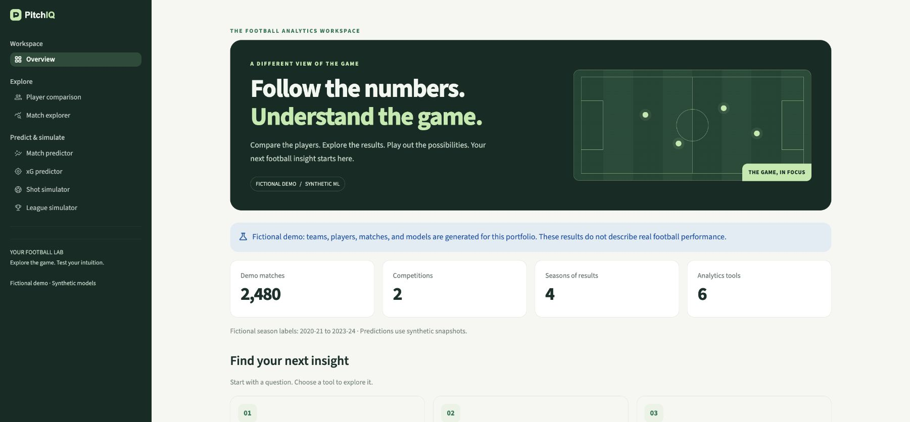

# PitchIQ

**[Try PitchIQ](https://pitchiq-demo.streamlit.app/)** · [GitHub repo](https://github.com/ArnavKV/PitchIQ)



I'm a first-year CS student who enjoys football and wanted to build something with the data behind the game. PitchIQ started as a way to try out Python, machine learning, and sports analytics together. It's still a work in progress, and I've been adding things as I learn.

The app is built with Streamlit, pandas, and scikit-learn. You can explore match results, compare players, try match and shot predictions, and run season simulations.

## Try it

**Live app:** https://pitchiq-demo.streamlit.app/

The three match-related pages let you switch between real OpenFootball results and a fictional demo. The player and shot tools use **fictional sample data** on the public site. I've kept the real player/shot datasets and their trained models out of this repo because the data sources have different usage terms.

| Page | What it does | Public data |
| --- | --- | --- |
| Player comparison | Compare goals, assists, minutes and per-90 stats | Fictional demo |
| Match explorer | Filter scores by season, competition, team and date | OpenFootball or demo |
| Match predictor | Estimate win/draw/loss probabilities and possible scores | OpenFootball or demo |
| xG predictor | Pick a shot location and estimate how likely a goal is | Fictional demo |
| Shot simulator | Try a shot and watch a simple animation | Fictional demo |
| League simulator | Simulate league finishes and a hypothetical UCL knockout cup | OpenFootball or demo |

### About the real match data

Match Explorer includes results from the top five European domestic leagues from **2020–21 onward**, and historical Champions League results through **2025–26**, subject to what OpenFootball has published. The **2026–27** season is ongoing, so its results and fixture lists are incomplete and may not update immediately.

The Match Predictor and League Simulator can use the available **2026–27** domestic-league results and fixtures. Their models train on earlier seasons, then use completed current-season matches for team form. The app never treats an unplayed fixture as a finished draw.

These are **experimental estimates**, not reliable predictions of real upcoming matches. The models don't know about team news, transfers, injuries, starting lineups or every competition rule. The UCL simulator is a **made-up knockout bracket**, not the real 2026–27 draw.

## Run it locally

The pinned dependencies were tested with **Python 3.14**.

```bash
python3 -m venv .venv
source .venv/bin/activate
python -m pip install -r requirements.txt
python -m streamlit run app.py
```

On Windows, use `.venv\Scripts\activate` instead of the `source` command. If your installed `python3` isn't Python 3.14, switch to 3.14 before creating the environment.

The app works with fictional data without API keys or downloads. The real match pages need an internet connection; results are fetched from OpenFootball and cached temporarily by Streamlit. Nothing needs to be copied into `data/` or `models/` to try the public version.

For an explicitly offline demo:

```bash
PITCHIQ_DATA_MODE=demo python -m streamlit run app.py
```

## How I built it

- **Python / pandas:** cleaning match records, filtering data and tracking recent team form.
- **scikit-learn:** logistic regression for match outcomes and Poisson regression for goal estimates.
- **Elo ratings:** a simple way to represent team strength as matches are played.
- **Monte Carlo simulation:** running lots of possible season finishes instead of presenting one fixed table.
- **Streamlit / Altair:** turning all of that into something you can click through.

A few choices are deliberately simple. League simulations hold estimated team strength fixed during each run, and the UCL simulator doesn't recreate official qualification or the draw. I'd rather show those limitations than make the numbers look more certain than they are.

## Tests

```bash
PITCHIQ_DATA_MODE=demo python -m unittest discover -s tests -v
python -m compileall -q app.py pitchiq pages views scripts
python scripts/check_publication.py --tracked
```

GitHub Actions runs the test suite and checks that research datasets and model files haven't slipped into the public repo. The tests don't guarantee that OpenFootball will always be available or that the models are accurate on future matches.

## Project layout

```text
app.py            Streamlit navigation
pages/            The six tools
pitchiq/          Data loading, models and simulation helpers
views/            Home page
assets/           Styling and shot animation
tests/            Model, UI and data checks
scripts/          Public-repo checks and export tools
```

Some optional scripts (`prepare_shots.py`, `prepare_players.py`, `train_xg.py` and others) come from the research version. They aren't needed to run the public demo. See [third-party notices](THIRD_PARTY_NOTICES.md) for data-source details and [publication notes](docs/PUBLICATION.md) for how this code-only repo is maintained.

The original project code is MIT-licensed. Data sources and their trademarks keep their own terms. PitchIQ isn't affiliated with any football league, club or data provider.
